# DBMS Mini Project Report

## 1. Title

**Research Paper Discovery & Collaboration System**
A web application for academic paper discovery and organization.

## 2. Students

| SRN | Name |
|---|---|
| PES2UG24CS013 | Aaruni Choudhary |
| PES2UG24CS060 | Anchita Chhibba |

## 3. Abstract

Academic literature is growing rapidly, while keyword-only discovery can miss useful work described with different terminology. Paperloom is a web application for searching research papers using a hybrid database design: MySQL stores canonical paper and user data, while MongoDB Atlas Vector Search stores paper embeddings and ranks semantic matches. The Next.js app generates embeddings locally with Ollama's `nomic-embed-text` model, so semantic retrieval does not require a paid embedding API key. Admins can index the MySQL paper library; signed-in users can run semantic search. Accounts use database-backed `Researcher` and `Admin` roles; admin-only APIs manage paper records and run the SQL evaluation demo. Saved papers and collections are stored in browser-local storage; authenticated collaboration workflows remain future work.

## 4. Tech Stack

| Component | Implemented technology | Responsibility |
|---|---|---|
| Web client | Next.js App Router, React, TypeScript | Search UI, paper details, collections, groups, discussions |
| Relational database | MySQL 8 | Users/roles, papers/authors, interests, bookmarks, collections, groups, discussions |
| Vector store | MongoDB Atlas Vector Search | Stores paper embeddings and returns nearest-neighbor paper IDs |
| Application layer | Next.js server routes/actions | Parameterized MySQL search, registration/sign-in, and Admin-only paper management |
| Password and session handling | Node.js crypto (scrypt and HMAC) | Salted password hashes and signed, HTTP-only session cookies |
| Embeddings | Ollama `nomic-embed-text` running locally | Embeds paper title/abstract and query text at 768 dimensions; no hosted API key or per-request fee |

The stack above is the implementation used by the project.

## 5. SQL Database Commands

The actual MySQL DDL and application query statements are in [`../database/mysql/schema.sql`](../database/mysql/schema.sql) and [`../database/sql/queries.sql`](../database/sql/queries.sql). The setup creates the relational tables and indexes and loads the records used by the application. The `papers` table is excerpted from the project schema:

```sql
CREATE TABLE IF NOT EXISTS papers (
  paper_id BIGINT UNSIGNED NOT NULL AUTO_INCREMENT PRIMARY KEY,
  title TEXT NOT NULL,
  abstract TEXT NOT NULL,
  doi VARCHAR(255) UNIQUE,
  publication_year SMALLINT UNSIGNED,
  venue VARCHAR(255),
  paper_url TEXT,
  created_at TIMESTAMP NOT NULL DEFAULT CURRENT_TIMESTAMP,
  CONSTRAINT chk_papers_year CHECK (publication_year IS NULL OR publication_year BETWEEN 1000 AND 2200),
  INDEX idx_papers_year (publication_year)
)
ENGINE=InnoDB DEFAULT CHARSET=utf8mb4 COLLATE=utf8mb4_0900_ai_ci;

SELECT p.paper_id, p.title, p.publication_year, p.venue
FROM papers AS p
WHERE p.title LIKE ? OR p.abstract LIKE ?
ORDER BY p.publication_year DESC, p.paper_id DESC
LIMIT 20;
```

The schema also defines roles, users, authors, paper-author relationships, interests, paper topics, collections, bookmarks, research groups, group memberships, and discussions, with foreign keys, uniqueness rules, checks, and indexes. The Next.js API uses parameterized MySQL queries. Admin paper creation, update, and deletion use `INSERT`, `UPDATE`, and `DELETE` in [`../apps/web/app/api/admin/papers/route.ts`](../apps/web/app/api/admin/papers/route.ts); keyword search uses `SELECT` from [`../apps/web/app/api/papers/route.ts`](../apps/web/app/api/papers/route.ts). Do not store plaintext passwords. The base schema creates tables and indexes; the advanced setup script separately ensures a FULLTEXT index and installs routines, triggers, and a view. Bookmark, group, and discussion statements in the SQL query file document the relational design; those user-facing workflows are not implemented.

### Advanced MySQL 8 evaluation examples

[`../database/mysql/advanced_concepts_demo.sql`](../database/mysql/advanced_concepts_demo.sql) contains executable JOIN, GROUP BY/COUNT, correlated and nested subquery, UPDATE, DELETE, trigger-audit, full-text search, stored-procedure, view, transaction, and row-lock examples. The UPDATE and DELETE demonstrations inspect the trigger's JSON audit record inside an InnoDB transaction and then roll it back; these examples do not leave sample data changed. [`../database/mysql/advanced_concepts.sql`](../database/mysql/advanced_concepts.sql) implements the audit table and triggers, ranked-search and bookmark procedures, and the engagement view. The app uses the FULLTEXT index for keyword search; the demo-only procedures and view are not called by the app. The Windows setup script installs the advanced objects automatically. Cross-platform manual commands are in [`../database/mysql/ADVANCED_CONCEPTS.md`](../database/mysql/ADVANCED_CONCEPTS.md). An Admin-only `POST /api/admin/evaluation` route now runs the JOIN, GROUP BY, correlated/nested subquery, aggregate view, and trigger-backed UPDATE/DELETE examples against live MySQL data and returns their result tables to the `/admin` page. The writes are rolled back before results are returned. The examples must still be run on the submission machine before reporting them as verified there.

### Relational model / ER diagram

The diagram shows the main MySQL relationships. Associative tables represent many-to-many relationships; `paper_topics` uses a composite key.

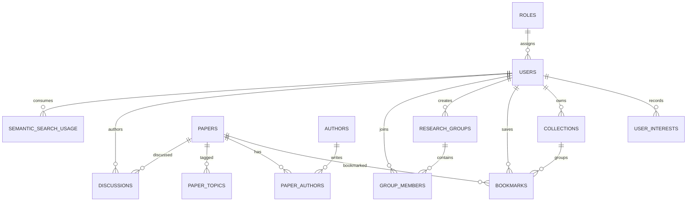

For exact columns, primary and foreign keys, and constraints, see [`../database/mysql/schema.sql`](../database/mysql/schema.sql).

## 6. NoSQL / Vector Database Commands

The application uses MongoDB Atlas Vector Search for semantic retrieval. Admins generate and upsert embeddings for MySQL papers through a keyset-paginated API that skips unchanged paper text. Local Ollama `nomic-embed-text` produces 768-dimensional vectors with document/query prefixes; Atlas stores each vector with its MySQL `paper_id`, title, abstract, topics, and model metadata. Search embeds the query locally, retrieves ranked IDs with cosine similarity, and loads authoritative paper details from MySQL. Signed-in accounts are limited to 30 semantic searches per UTC day using a MySQL usage table. Configure local Ollama and `MONGODB_URI` in ignored `.env.local`, create the 768-dimensional Atlas index from [`../database/vector/atlas-vector-index.json`](../database/vector/atlas-vector-index.json), and run Admin indexing. No OpenAI API key is used. See [`../database/vector/README.md`](../database/vector/README.md) for commands and the indexing/search workflow.

The implemented MongoDB `$vectorSearch` aggregation is in [`../apps/web/lib/vector-db.ts`](../apps/web/lib/vector-db.ts). It receives a live Ollama query vector, filters by the configured model and optional topic, and returns ranked MySQL paper IDs with similarity scores. Admin ingestion is implemented in [`../apps/web/app/api/admin/vector-index/route.ts`](../apps/web/app/api/admin/vector-index/route.ts); the index definition is [`../database/vector/atlas-vector-index.json`](../database/vector/atlas-vector-index.json).

## 7. Next.js Project Tree

Implemented Next.js app tree:

```text
apps/web/
├── app/
│   ├── api/papers/route.ts
│   ├── api/health/route.ts
│   ├── api/auth/route.ts
│   ├── api/admin/papers/route.ts
│   ├── api/admin/vector-index/route.ts
│   ├── api/admin/evaluation/route.ts
│   ├── admin/page.tsx
│   ├── login/page.tsx
│   ├── globals.css
│   ├── layout.tsx
│   └── page.tsx
├── lib/db.ts
├── lib/auth.ts
├── lib/authorization.ts
├── lib/embeddings.ts
├── lib/vector-db.ts
├── package.json
└── .env.example

database/
├── mysql/schema.sql
├── mysql/seed.sql
├── mysql/promote-admin.sql
├── mysql/AUTHORIZATION.md
└── vector/atlas-vector-index.json
```

## 8. Screenshots from the Running Application

These screenshots document the Paperloom sign-in and researcher views, MySQL administration, the live SQL evaluation demo, keyword search, semantic search, saved papers, and collections. They are supplied captures of the running application.

### Authentication and paper administration

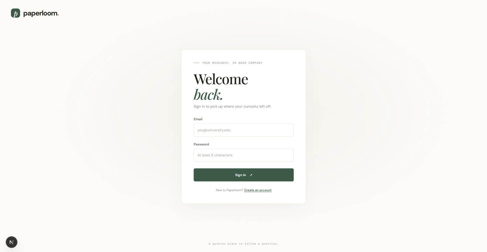

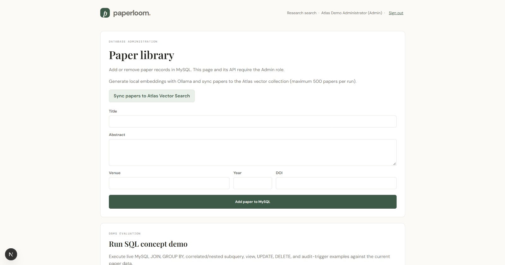

### Live SQL evaluation

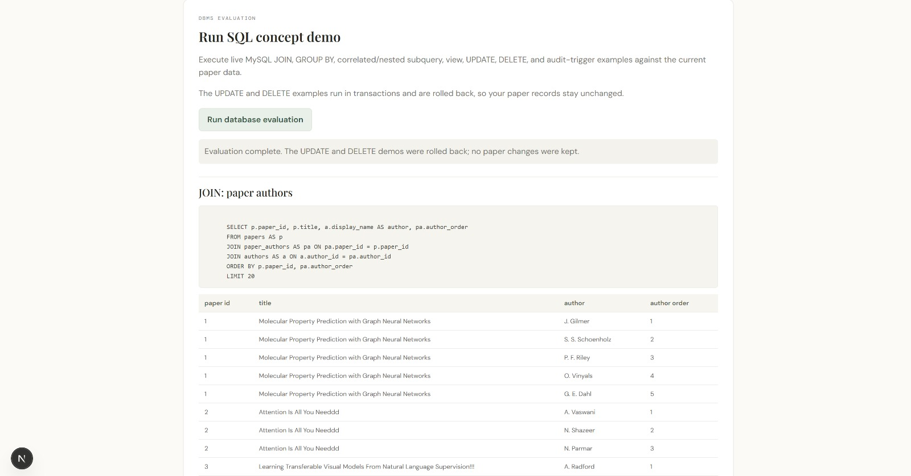

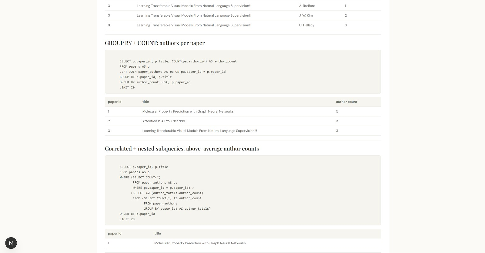

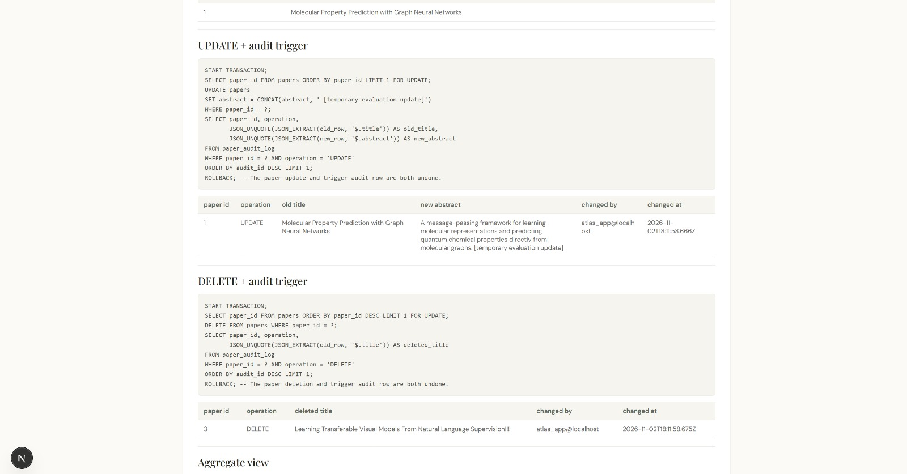

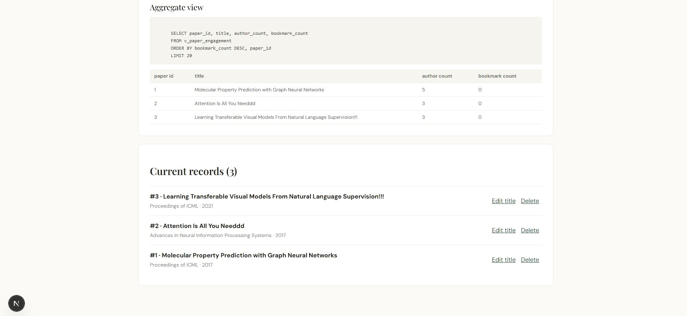

### Researcher discovery and library

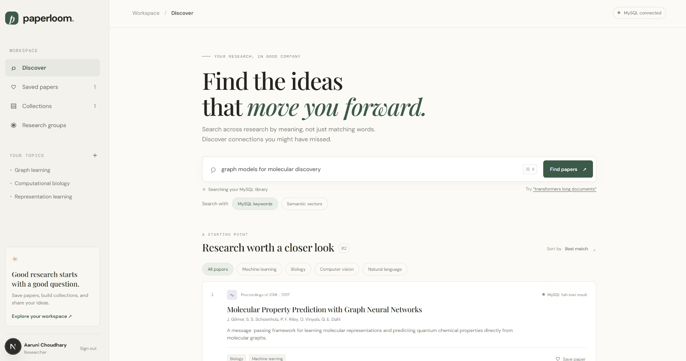

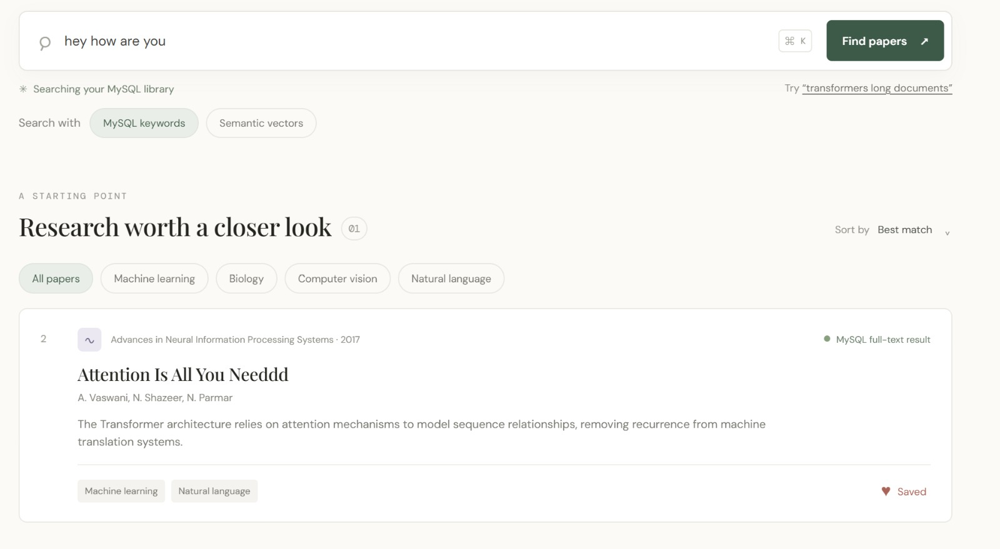

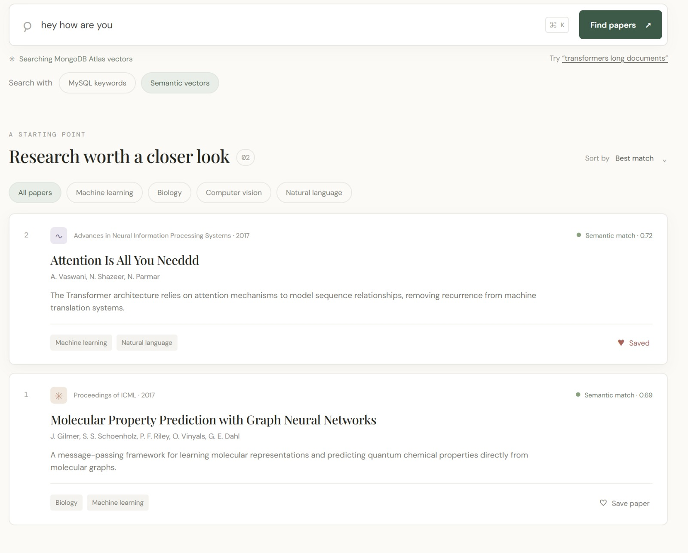

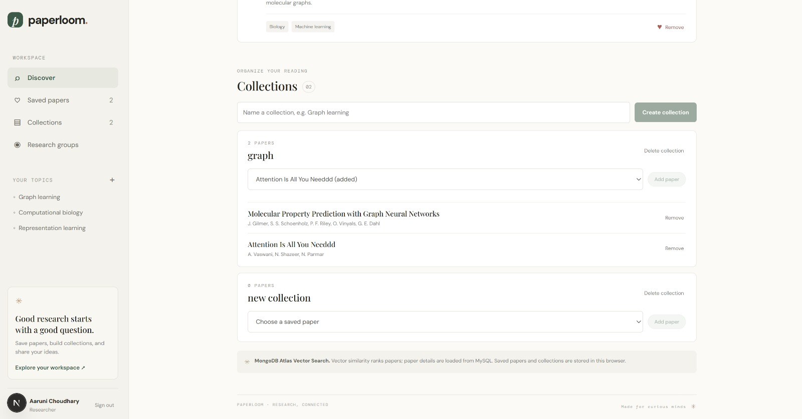

The search implementation is in `apps/web/app/api/papers/route.ts`; registration, sign-in, and role checks are implemented through `apps/web/app/api/auth/route.ts` and `apps/web/lib/authorization.ts`. The SQL evaluation is run through the Admin-only `/api/admin/evaluation` endpoint. The captures evidence the UI and results visible at capture time; rerun database setup and evaluation on another machine before claiming its local database state is verified there.

## 9. Problem, Objectives, Scope, and Requirements

### Problem statement

Keyword search can miss relevant research when a paper describes an idea using different terms. Researchers also need a way to organize a paper library while keeping structured records consistent.

### Objectives

1. Store papers and related relational records in MySQL with keys and constraints.
2. Support keyword search in MySQL and meaning-based paper retrieval using MongoDB Atlas Vector Search.
3. Protect paper administration through Researcher and Admin roles.
4. Demonstrate database integration through a Next.js application and reproducible SQL/NoSQL commands.

### Scope and functional requirements

| Requirement | Implementation status |
|---|---|
| Search and filter the seeded paper library | Implemented with parameterized MySQL queries |
| Register/sign in as a Researcher; restrict Admin operations | Implemented with database roles and protected routes; sign-in and Admin screens are included |
| Add, edit, and remove paper records as Admin | Implemented through the Admin page and protected API |
| Create paper vectors and retrieve semantic matches | Semantic retrieval is implemented with local Ollama and Atlas; a result screen is included. Re-index the target database before a new demonstration. |
| Persist bookmarks, collections, research groups, and discussions | Represented in the relational schema; user-facing persistence workflows remain future work |

### Database choice and advanced DBMS concepts

MySQL is the system of record because users, papers, authors, and associations have structured relationships and integrity constraints. MongoDB Atlas is used for vector documents and approximate nearest-neighbor search; the document stores a MySQL paper ID, metadata, embedding model, content hash, and vector. MySQL remains authoritative for paper details.

Implemented database features include referential and check constraints, composite/unique keys and indexes, app keyword search through FULLTEXT, role-checked administration, a daily semantic-search quota, and cosine vector similarity retrieval. The advanced MySQL scripts additionally implement audit triggers, stored procedures, and a view; their evaluation script demonstrates JOIN, aggregation, correlated/nested subqueries, UPDATE, DELETE, transactions, and row locking. The scripts are reproducible examples, not application workflows: the app does not call the bookmark procedure or engagement view, and the SQL demo writes are rolled back.

### Key data dictionary

| Table | Primary key | Purpose / important relationships |
|---|---|---|
| `roles` | `role_id` | Role names referenced by `users` |
| `users` | `user_id` | Account identity, password hash, and role foreign key |
| `papers` | `paper_id` | Canonical paper details and publication metadata |
| `authors` | `author_id` | Unique author names |
| `paper_authors` | (`paper_id`, `author_id`) | Paper/author many-to-many link and author order |
| `paper_topics` | (`paper_id`, `topic`) | Paper topic tags and topic lookup index |
| `bookmarks` | (`user_id`, `paper_id`) | User saves a paper, optionally into a collection |
| `collections` | `collection_id` | User-owned named paper collections |
| `research_groups`, `group_members` | `group_id`; (`group_id`, `user_id`) | Group ownership and group membership |
| `discussions` | `discussion_id` | Discussion entries linked to a paper and author |
| `semantic_search_usage` | (`user_id`, `usage_date`) | Per-user daily semantic request counter |

See the complete relational schema for all attributes, nullability, indexes, and constraints.

## 10. Architecture, Conclusion, and Future Work

### Architecture and data flow

The browser calls Next.js route handlers. Keyword search and authentication use MySQL. For semantic search, the server sends the query to the local Ollama embedding endpoint, uses that vector to query MongoDB Atlas, then resolves the returned paper IDs from MySQL. Admin indexing reads source paper text from MySQL, creates vectors locally, and upserts them to Atlas. Secrets remain in the ignored local environment file.

### Conclusion

The project demonstrates a hybrid DBMS design that combines relational integrity and SQL queries with a vector document store and similarity search. Local Ollama removes dependency on paid OpenAI API credits for embedding generation. The application and database scripts provide a repeatable implementation path; final demo evidence should record the actual database, role, indexing, and retrieval checks from the submission machine.

### Future work

- Persist bookmarks and collections through authenticated APIs.
- Implement research-group and discussion workflows.
- Add paper ingestion from scholarly sources and evaluate retrieval quality on a larger dataset.
- Capture source-code evidence if required by the instructor.

## Repository

Recommended repository name: **`research-paper-discovery-collaboration`**. This name describes the project clearly and is suitable for a resume link. The local Git repository can be published under the same name on GitHub when ready.
