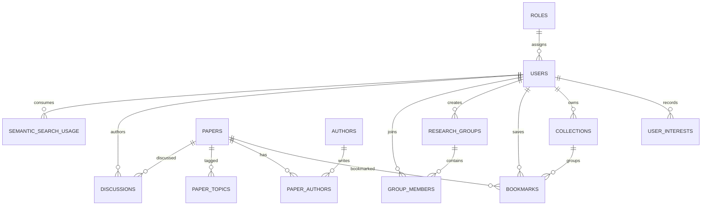
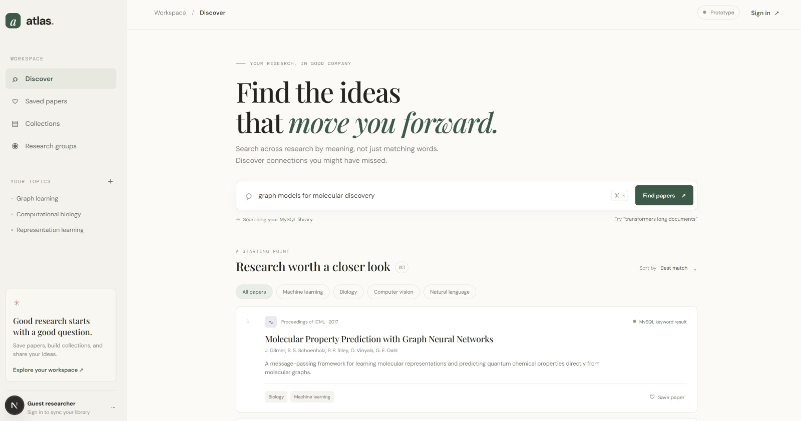
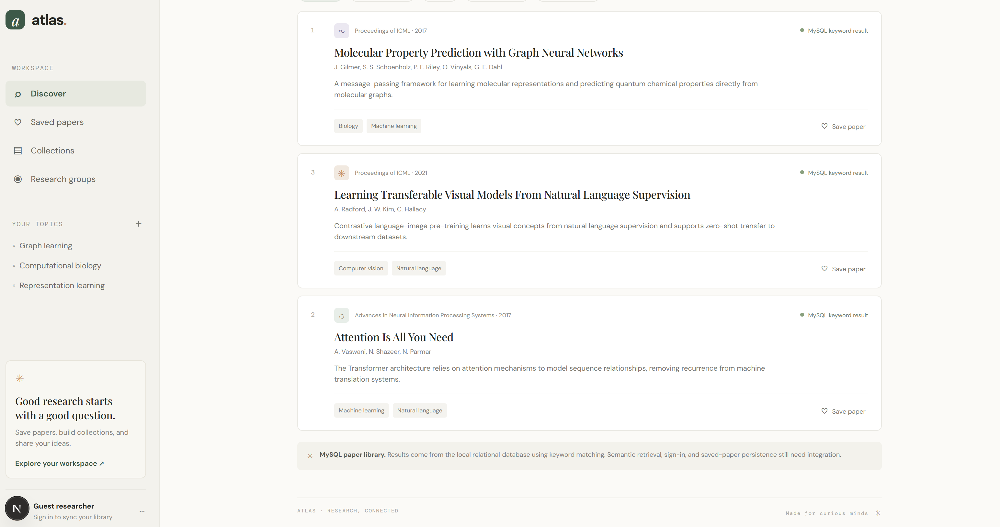
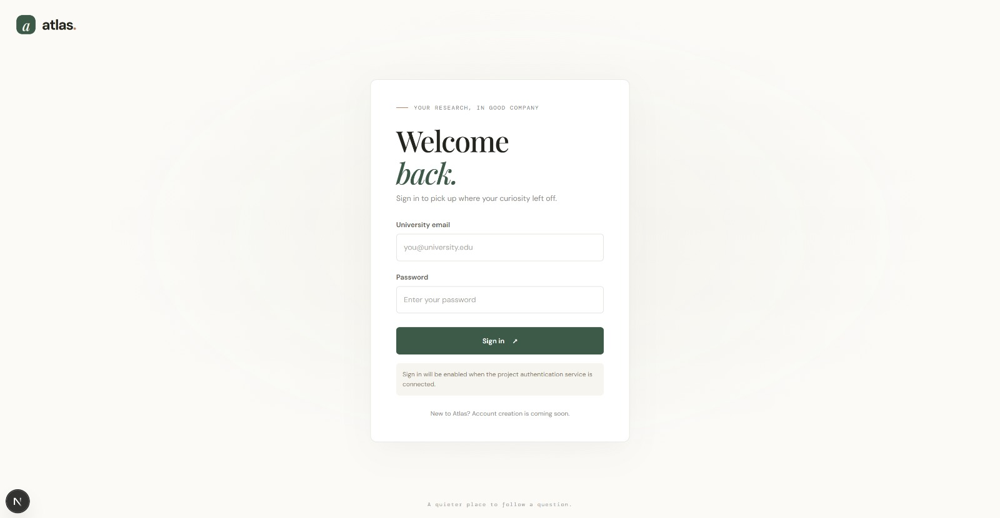

# DBMS Mini Project Report

## 1. Title

**Research Paper Discovery & Collaboration System**
A web application prototype for academic paper discovery, organization, and researcher collaboration.

## 2. Students

| SRN | Name |
|---|---|
| PES2UG24CS013 | Aaruni Choudhary |
| PES2UG24CS060 | Anchita Chhibba |

## 3. Abstract

Academic literature is growing rapidly, while keyword-only discovery can miss useful work described with different terminology. Atlas is a web application for searching research papers using a hybrid database design: MySQL stores canonical paper and user data, while MongoDB Atlas Vector Search stores paper embeddings and ranks semantic matches. The Next.js app generates embeddings locally with Ollama's `nomic-embed-text` model, so semantic retrieval does not require a paid embedding API key. Admins can index the MySQL paper library; signed-in users can run semantic search. Accounts use database-backed `Researcher` and `Admin` roles; admin-only APIs manage paper records. Passwords use scrypt hashes and sessions use signed HTTP-only cookies. Persisted collaboration workflows remain future work.

## 4. Tech Stack

| Component | Proposed technology | Responsibility |
|---|---|---|
| Web client | Next.js App Router, React, TypeScript | Search UI, paper details, collections, groups, discussions |
| Relational database | MySQL 8 | Users/roles, papers/authors, interests, bookmarks, collections, groups, discussions |
| Vector store | MongoDB Atlas Vector Search | Stores paper embeddings and returns nearest-neighbor paper IDs |
| Application layer | Next.js server routes/actions | Parameterized MySQL search, registration/sign-in, and Admin-only paper management |
| Password and session handling | Node.js crypto (scrypt and HMAC) | Salted password hashes and signed, HTTP-only session cookies |
| Embeddings | Ollama `nomic-embed-text` running locally | Embeds paper title/abstract and query text at 768 dimensions; no hosted API key or per-request fee |

The supplied brief does not prescribe specific vendors or framework versions. The stack above is a proposed implementation choice.

## 5. SQL Database Commands

The MySQL DDL and representative search/bookmark commands are in [`../database/mysql/schema.sql`](../database/mysql/schema.sql) and [`../database/sql/queries.sql`](../database/sql/queries.sql). A separate [`../database/sql/ddl-examples.sql`](../database/sql/ddl-examples.sql) demonstrates `CREATE`, `ALTER`, and `DROP` against a disposable staging table; do not use that demo table as application data. A local setup script creates a restricted app account and loads sample papers. Example:

```sql
CREATE TABLE papers (
  paper_id BIGINT UNSIGNED NOT NULL AUTO_INCREMENT PRIMARY KEY,
  title TEXT NOT NULL,
  abstract TEXT NOT NULL DEFAULT '',
  doi VARCHAR(255) UNIQUE,
  publication_year SMALLINT CHECK (publication_year BETWEEN 1000 AND 2200)
);

SELECT paper_id, title, publication_year
FROM papers
WHERE title LIKE CONCAT('%', ?, '%')
   OR abstract LIKE CONCAT('%', ?, '%')
ORDER BY publication_year DESC
LIMIT 20;
```

The schema also defines roles, users, authors, paper-author relationships, interests, paper topics, collections, bookmarks, research groups, group memberships, and discussions, with foreign keys, uniqueness rules, checks, and indexes. The Next.js API uses parameterized MySQL queries. Do not store plaintext passwords. The schema and query file provide DDL/DML examples, including table creation, inserts, updates, deletes, joins, grouping, and transaction-safe bookmark operations.

### Relational model / ER diagram

The diagram shows the main MySQL relationships. Associative tables represent many-to-many relationships; `paper_topics` uses a composite key.



For exact columns, primary and foreign keys, and constraints, see [`../database/mysql/schema.sql`](../database/mysql/schema.sql).

## 6. NoSQL / Vector Database Commands

The application uses MongoDB Atlas Vector Search for semantic retrieval. Admins generate and upsert embeddings for MySQL papers through a keyset-paginated API that skips unchanged paper text. Local Ollama `nomic-embed-text` produces 768-dimensional vectors with document/query prefixes; Atlas stores each vector with its MySQL `paper_id`, title, abstract, topics, and model metadata. Search embeds the query locally, retrieves ranked IDs with cosine similarity, and loads authoritative paper details from MySQL. Signed-in accounts are limited to 30 semantic searches per UTC day using a MySQL usage table. Configure local Ollama and `MONGODB_URI` in ignored `.env.local`, create the 768-dimensional Atlas index from [`../database/vector/atlas-vector-index.json`](../database/vector/atlas-vector-index.json), and run Admin indexing. No OpenAI API key is used. See [`../database/vector/README.md`](../database/vector/README.md) for commands and the indexing/search workflow.

Example Atlas aggregation (replace the abbreviated vector with an embedding returned by the same Ollama model):

```javascript
db.paper_vectors.aggregate([
  { $vectorSearch: {
      index: "paper_embedding_index", path: "embedding",
      queryVector: [/* 768 values from nomic-embed-text */],
      numCandidates: 200, limit: 10,
      filter: { embedding_model: "nomic-embed-text" }
  }},
  { $project: { _id: 0, paper_id: 1, score: { $meta: "vectorSearchScore" } } }
]);
```

## 7. Next.js Project Tree

Implemented Next.js app tree:

```text
apps/web/
├── app/
│   ├── api/papers/route.ts
│   ├── api/health/route.ts
│   ├── api/auth/route.ts
│   ├── api/admin/papers/route.ts
│   ├── api/admin/vector-index/route.ts
│   ├── admin/page.tsx
│   ├── login/page.tsx
│   ├── globals.css
│   ├── layout.tsx
│   └── page.tsx
├── lib/db.ts
├── lib/auth.ts
├── lib/authorization.ts
├── lib/embeddings.ts
├── lib/vector-db.ts
├── package.json
└── .env.example

database/
├── mysql/schema.sql
├── mysql/seed.sql
├── mysql/promote-admin.sql
├── mysql/AUTHORIZATION.md
└── vector/atlas-vector-search.js
```

## 8. Sample Screenshots: Code and Demo

The following captures show the Atlas discovery interface and paper results. The two discovery captures show three sample papers loaded from the local MySQL database and labeled as MySQL keyword results.





The login image records the earlier sign-in screen, which still displayed a prototype notice at the time it was captured. The current code includes account registration and sign-in through `apps/web/app/api/auth/route.ts`; verify these flows against the configured local database before treating the image as authentication evidence. The search implementation is in `apps/web/app/api/papers/route.ts`, with connection settings loaded by `apps/web/lib/db.ts`. Screenshots do not show credentials or private user data. Add a semantic-search capture after Ollama is running, the Atlas index is active, and the admin indexing workflow has populated vectors.



### Verification checklist

Record real results from the demo before submission; the repository screenshots currently document the MySQL keyword UI, not a completed semantic-search run.

| Check | Expected evidence |
|---|---|
| MySQL connection and keyword search | `/api/health` reports MySQL connected; a keyword query returns seeded papers |
| Authentication and roles | Researcher sign-in succeeds; Researcher is denied the Admin indexing route; Admin can access `/admin` |
| Local embeddings | `ollama list` includes `nomic-embed-text`; Ollama returns 768 values from `/api/embed` |
| MongoDB connection and index | Atlas connection succeeds and `paper_embedding_index` is Active with 768 dimensions |
| Vector ingestion and retrieval | Admin sync indexes papers; semantic query returns paper IDs that resolve to MySQL records |

Do not report a checklist item as passed until demonstrated on the submission machine.

## 9. Problem, Objectives, Scope, and Requirements

### Problem statement

Keyword search can miss relevant research when a paper describes an idea using different terms. Researchers also need a way to organize a paper library while keeping structured records consistent.

### Objectives

1. Store papers and related relational records in MySQL with keys and constraints.
2. Support keyword search in MySQL and meaning-based paper retrieval using MongoDB Atlas Vector Search.
3. Protect paper administration through Researcher and Admin roles.
4. Demonstrate database integration through a Next.js application and reproducible SQL/NoSQL commands.

### Scope and functional requirements

| Requirement | Implementation status |
|---|---|
| Search and filter the seeded paper library | Implemented with parameterized MySQL queries |
| Register/sign in as a Researcher; restrict Admin operations | Implemented with database roles and protected routes; verify both roles in the submission demo |
| Add, edit, and remove paper records as Admin | Implemented through the Admin page and protected API |
| Create paper vectors and retrieve semantic matches | Implemented with local Ollama embeddings and MongoDB Atlas; requires the Admin indexing run for the current data |
| Persist bookmarks, collections, research groups, and discussions | Represented in the relational schema; user-facing persistence workflows remain future work |

### Database choice and advanced DBMS concepts

MySQL is the system of record because users, papers, authors, and associations have structured relationships and integrity constraints. MongoDB Atlas is used for vector documents and approximate nearest-neighbor search; the document stores a MySQL paper ID, metadata, embedding model, content hash, and vector. MySQL remains authoritative for paper details.

The project demonstrates referential and check constraints, composite/unique keys and indexes, transaction-based bookmark writes, role-checked data administration, daily semantic-search quotas, and cosine vector similarity retrieval. These provide multiple database concepts beyond basic CRUD.

### Key data dictionary

| Table | Primary key | Purpose / important relationships |
|---|---|---|
| `roles` | `role_id` | Role names referenced by `users` |
| `users` | `user_id` | Account identity, password hash, and role foreign key |
| `papers` | `paper_id` | Canonical paper details and publication metadata |
| `authors` | `author_id` | Unique author names |
| `paper_authors` | (`paper_id`, `author_id`) | Paper/author many-to-many link and author order |
| `paper_topics` | (`paper_id`, `topic`) | Paper topic tags and topic lookup index |
| `bookmarks` | (`user_id`, `paper_id`) | User saves a paper, optionally into a collection |
| `collections` | `collection_id` | User-owned named paper collections |
| `research_groups`, `group_members` | `group_id`; (`group_id`, `user_id`) | Group ownership and group membership |
| `discussions` | `discussion_id` | Discussion entries linked to a paper and author |
| `semantic_search_usage` | (`user_id`, `usage_date`) | Per-user daily semantic request counter |

See the complete relational schema for all attributes, nullability, indexes, and constraints.

## 10. Architecture, Conclusion, and Future Work

### Architecture and data flow

The browser calls Next.js route handlers. Keyword search and authentication use MySQL. For semantic search, the server sends the query to the local Ollama embedding endpoint, uses that vector to query MongoDB Atlas, then resolves the returned paper IDs from MySQL. Admin indexing reads source paper text from MySQL, creates vectors locally, and upserts them to Atlas. Secrets remain in the ignored local environment file.

### Conclusion

The project demonstrates a hybrid DBMS design that combines relational integrity and SQL queries with a vector document store and similarity search. Local Ollama removes dependency on paid OpenAI API credits for embedding generation. The application and database scripts provide a repeatable implementation path; final demo evidence should record the actual database, role, indexing, and retrieval checks from the submission machine.

### Future work

- Persist bookmarks and collections through authenticated APIs.
- Implement research-group and discussion workflows.
- Add paper ingestion from scholarly sources and evaluate retrieval quality on a larger dataset.
- Capture verified semantic-search and role-based authorization screenshots for the final submission.

## Repository

Recommended repository name: **`research-paper-discovery-collaboration`**. This name describes the project clearly and is suitable for a resume link. The local Git repository can be published under the same name on GitHub when ready.
